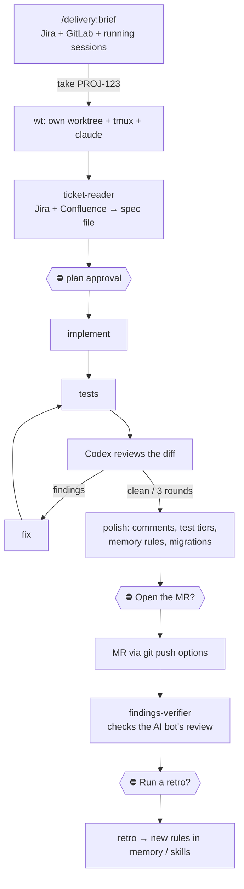

# agentic-delivery

A Claude Code plugin: from a Jira issue to a merge request, with the human approving only
three times.



```
/delivery:brief            what needs me today; "take PROJ-123" starts it in its own session
/delivery:task PROJ-123    the pipeline above
```

## What agents get wrong → what the pipeline does

| Agents… | Here |
|---|---|
| review their own code with their own blind spots | another model (Codex) reviews; a bot's review is checked by a fresh agent, not by the author |
| quietly reinterpret the spec | the spec file is frozen; a deviation needs the user's answer quoted verbatim |
| forget rules agreed in earlier tasks | `polish` checks the diff against the memory rules it touches |
| act too eagerly: commit, push, comment | three gates, read-only tokens, no force-push |
| drown in a 60-comment ticket | a subagent reads it and writes a short spec; the session works from that |
| write code nothing calls | every new piece must name its entry point at the plan gate |
| loop on review forever | at most 3 Codex rounds |
| repeat yesterday's mistakes | `retro` turns them into memory, skill or hook changes |

Anything deterministic is a script, not a prompt: API clients, git safety checks, migration
conflicts.

> **Reference implementation.** I run this daily with a different issue tracker and a self-hosted
> GitLab. The public version uses Jira Cloud and is tested against a fake Jira server, not
> a live one.

## Install

```bash
/plugin marketplace add editorgit/agentic-delivery
/plugin install delivery@agentic-delivery
cp -r codex/delivery-reviewer ~/.codex/skills/                    # the Codex review rules
mkdir -p ~/.config/agentic-delivery
cp examples/env.example ~/.config/agentic-delivery/.env           # Jira + GitLab read-only tokens
cp examples/delivery.json <repo>/.claude/delivery.json            # optional project settings
```

Needs Claude Code, git, Python 3.10+, the Codex CLI, and [wt](https://github.com/editorgit/wt)
for starting tasks from the brief. Settings and the spec file format:
[docs/configuration.md](docs/configuration.md).

Tests: `python3 -m unittest discover -s tests`

MIT
